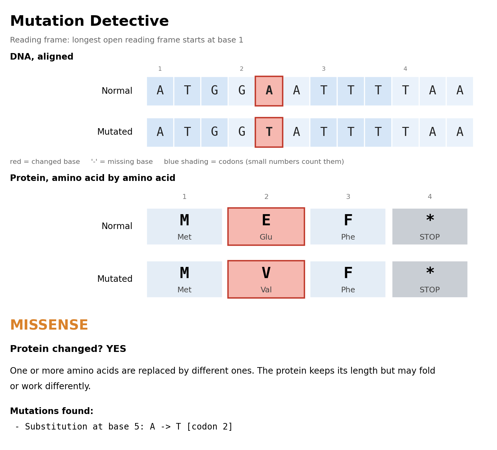

# Mutation Detective

**What does a DNA mutation change?**

Mutation Detective compares a normal DNA sequence with a mutated copy. It finds the mutation, translates both sequences into amino acids (the building blocks of a protein), and tells you whether the protein changes and in what way.



*The picture above was made by the program itself. The `A` to `T` change in the DNA turns the amino acid Glu (E) into Val (V). Everything else in the protein is untouched, so this is a **missense** mutation.*

## Files

| File | What it is |
|---|---|
| `mutation_detective_final.py` | The program. A guide at the top of the file explains how it works. |
| `test_mutation_detective.py` | Automated tests (48 of them). |
| `mutation_example.png` | A sample picture produced by the program. |
| `README.md` | This file. |

## What you need

* **Python 3.8 or newer.** Nothing else is required to run the program.
* **matplotlib**, only if you want the picture (`--image`). Install it with `python3 -m pip install matplotlib`.

> **On a Mac, type `python3`, not `python`.** macOS has no command called `python`, which gives "command not found".

## How to run it

Open a terminal, go to the folder that holds the file (for example `cd ~/Downloads`), then use one of these:

```bash
# 1. Give the two sequences directly: normal first, mutated second
python3 mutation_detective_final.py ATGGAATTTTAA ATGGTATTTTAA

# 2. Run it with no arguments and type the sequences when asked
python3 mutation_detective_final.py

# 3. Also save a picture of the comparison
python3 mutation_detective_final.py ATGGAATTTTAA ATGGTATTTTAA --image result.png

# 4. Tell it where the start codon is (position of the A in ATG, counting from 1)
python3 mutation_detective_final.py NORMAL MUTATED --start 3
```

Sequences use the letters `A`, `T`, `C` and `G`. RNA letters (`U`) are accepted and converted. Spaces and line breaks are ignored.

## What it tells you

| Verdict | Meaning |
|---|---|
| **SILENT** | The DNA changed, but the amino acid did not. |
| **MISSENSE** | One amino acid is swapped for a different one. |
| **NONSENSE** | A codon becomes a STOP, so the protein is cut short. |
| **STOP-LOSS** | The STOP codon is destroyed, so the protein runs on too long. |
| **START LOSS** | The start codon (ATG) is destroyed. |
| **FRAMESHIFT** | Bases were added or removed (not in multiples of 3), so every codon after that point is misread. |
| **TEMPORARY FRAMESHIFT** | An insertion and a deletion cancel out in length, but the codons between them are misread. |
| **IN-FRAME INDEL** | Bases were added or removed in multiples of 3, so amino acids are gained or lost but the rest is fine. |
| **NO PROTEIN CHANGE** | The DNA changed outside the part that makes the protein (before the start codon or after the stop codon). |
| **NONE** | The sequences are identical. |

## Sample results

These are real outputs, shortened a little.

**Silent**: `ATGGCTGAAAAGCTGTAA` vs `ATGGCCGAAAAGCTGTAA`

```text
- Substitution at base 6: T -> C  [codon 2]
Normal protein:  MAEKL*
Mutated protein: MAEKL*
Residue 2: GCT (Ala) -> GCC (Ala)  [same amino acid]
Protein changed? NO
SILENT: the DNA changed, but every altered codon still codes for the same amino acid, so the protein is identical.
```

**Missense**: `ATGGAATTTTAA` vs `ATGGTATTTTAA`

```text
- Substitution at base 5: A -> T  [codon 2]
Normal protein:  MEF*
                  ^
Mutated protein: MVF*
Residue 2: GAA (Glu) -> GTA (Val)  [amino acid changes]
Protein changed? YES
MISSENSE: one or more amino acids are replaced by different ones. ...
```

**Nonsense**: `ATGGCTGAAAAGCTGTAA` vs `ATGGCTTAAAAGCTGTAA`

```text
- Substitution at base 7: G -> T  [codon 3]
Normal protein:  MAEKL*
                   ^^^^
Mutated protein: MA*
Residue 3: GAA (Glu) -> TAA (STOP)  [amino acid changes]
NONSENSE: a premature stop codon appears at residue 3, shortening the protein from 5 to 2 amino acids.
```

**Frameshift**: `ATGGCTGAAAAGCTGTAA` vs `ATGGCTGAAAGCTGTAA`

```text
- Deletion at base 11: A (1 base(s))  [codon 4]
Normal protein:  MAEKL*
                    ^^^
Mutated protein: MAESC
FRAMESHIFT: the net change in length is not a multiple of 3, so every codon after the mutation is read in a shifted frame (protein first differs at residue 4).
```

## How it works, in short

1. **Clean** the input and check it only contains A, T, C and G.
2. **Align** the two sequences to find every substitution, insertion and deletion. A one-base insertion or deletion is preferred over a long run of substitutions, which matches how mutations really happen.
3. **Find the reading frame.** A protein is read in groups of three bases starting at an `ATG`. The program picks the longest open reading frame automatically, or you can give `--start`.
4. **Translate** both sequences with the standard genetic code, stopping at the first STOP codon.
5. **Classify** the difference between the two proteins and print the report (and the picture, if asked).

The top of `mutation_detective_final.py` explains each step and names the function that does it.

## Running the tests

From the folder that holds both Python files:

```bash
python3 -m unittest -v test_mutation_detective
```

The tests use only the standard library. They check that:

* input cleaning and translation behave correctly,
* the alignment is valid (it rebuilds the mutated sequence exactly, including 150 random mutations),
* every verdict above is reached by at least one example,
* the reading frame is chosen and overridden correctly,
* the text report, the picture and the command-line options work.

The picture tests are skipped automatically if matplotlib is not installed.

## Limitations

* It reads the **forward DNA strand** only. For a gene on the reverse strand, reverse-complement the sequences first.
* It uses the **standard genetic code**. Mitochondrial and other alternative codon tables are not supported.
* It treats the sequence as **one continuous coding region**, with no introns or splicing.
* The longest open reading frame is a good guess, but not always the real gene. Use `--start` if it picks the wrong one.
* It compares **one normal and one mutated sequence** at a time, and it does not judge how harmful a change is in real life. For example, a missense change may be harmless or serious depending on the protein.
* The picture shows at most 48 DNA columns and 16 amino acids at a time. For longer sequences it centres on the first difference.
